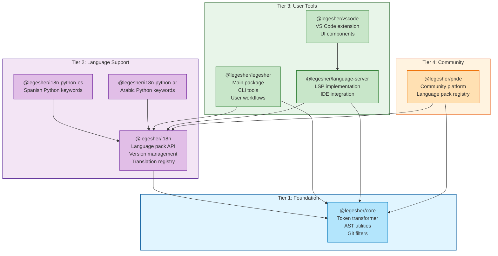
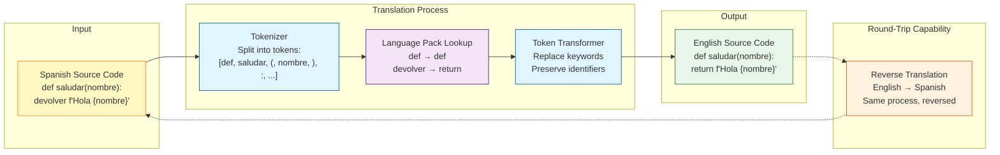
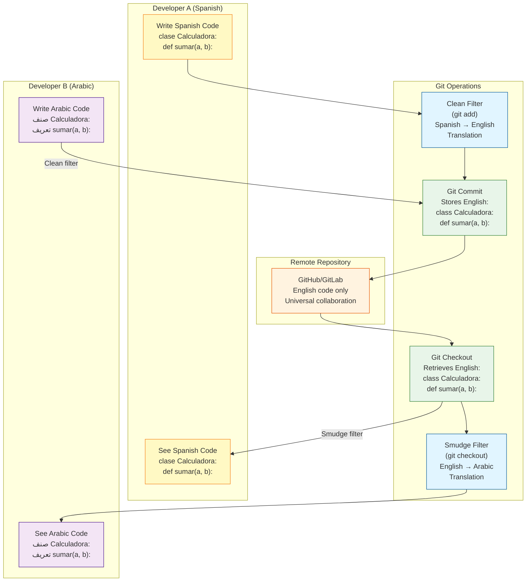
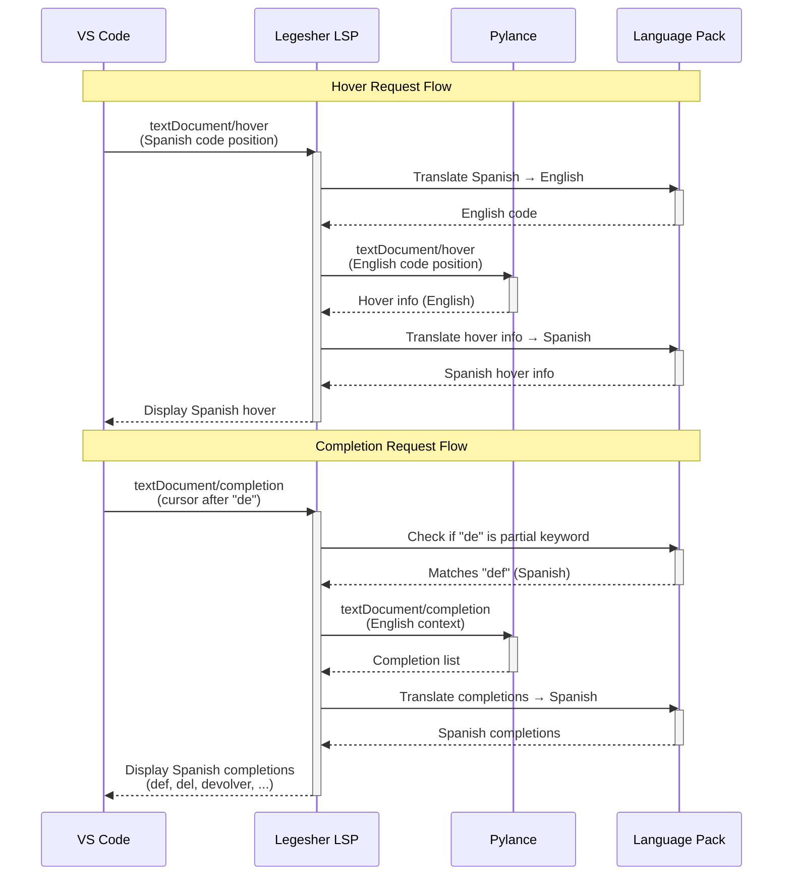
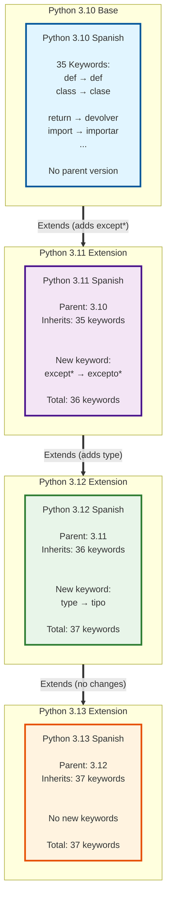

# Architecture Diagrams

**Last Updated:** 2025-11-07
**Purpose:** Visual architecture documentation for Legesher
**Audience:** Developers, contributors, and architects

---

## Overview

This document provides visual representations of Legesher's architecture using Mermaid diagrams. Each diagram
illustrates a critical aspect of the system, from package dependencies to runtime translation flows.

**Related Documentation:**

- Complete Architecture Guide (private-working-memory repository)
- Implementation Roadmap (private-working-memory repository)
- API Documentation (`/docs/api/`)
- Developer Guide (`/CONTRIBUTING.md`)

---

## 1. Package Architecture

This diagram shows the complete package structure of the Legesher monorepo, organized into four tiers based on
dependencies and functionality.

### Package Tiers Explained

**Tier 1 - Foundation:**

- `@legesher/core`: The foundation package containing the token transformer, AST utilities, and git filter
  implementations. Has zero external Legesher dependencies.

**Tier 2 - Language Support:**

- `@legesher/i18n`: Core language pack system with version management and translation registry
- `@legesher/i18n-python-es`: Spanish keyword translations for Python
- `@legesher/i18n-python-ar`: Arabic keyword translations for Python
- Additional language packs follow the same pattern

**Tier 3 - User Tools:**

- `@legesher/legesher`: Main user-facing package with CLI tools
- `@legesher/language-server`: LSP server for IDE integration
- `@legesher/vscode`: VS Code extension providing the user interface

**Tier 4 - Community:**

- `@legesher/pride`: Community platform and public language pack registry

### Key Takeaways

1. Clear separation of concerns across tiers
2. Foundation packages have no Legesher dependencies
3. Language packs are modular and can be added independently
4. User tools build on stable foundation and language support layers
5. Community layer depends on all lower tiers but is optional

---

## 2. Translation Flow

This diagram illustrates how Legesher translates code from one language to another using the token-based
approach (MVP implementation).

### Translation Steps Explained

**Step 1 - Tokenization:**

The source code is split into individual tokens (keywords, identifiers, operators, literals). The tokenizer
preserves whitespace and structure.

**Step 2 - Language Pack Lookup:**

Each token is checked against the language pack:

- Keywords (def, devolver) are mapped to English equivalents
- Identifiers (saludar, nombre) are preserved unchanged
- Operators and literals pass through unchanged

**Step 3 - Token Transformation:**

The TokenTransformer reconstructs the code with translated keywords while maintaining:

- Original formatting and indentation
- User-defined identifiers (variable/function names)
- Comments and docstrings
- String literals

**Round-Trip Translation:**

The same process works in reverse, allowing seamless translation between any supported language pair. This
enables teams to work in different languages on the same codebase.

### Package Architecture Key Takeaways

1. Token-based approach is simple and fast (MVP)
2. Preserves everything except keywords
3. Bidirectional translation support
4. No AST parsing required (future enhancement)
5. Works with existing Python tooling

---

## 3. Git Workflow

This diagram shows how Legesher integrates with Git using clean and smudge filters to maintain a canonical
English representation in the repository while allowing developers to work in their native languages.

### Git Integration Explained

**Clean Filter (Pre-Commit):**

When a developer commits code, the clean filter automatically translates their native language code to English
before it reaches the Git repository. This happens transparently during `git add` or `git commit`.

**Repository Storage:**

All code is stored in English in the Git repository. This provides:

- Universal collaboration across language barriers
- Compatibility with existing tools (GitHub, code review, CI/CD)
- Single source of truth for code review
- Language-agnostic diffs and merges

**Smudge Filter (Post-Checkout):**

When a developer checks out code, the smudge filter translates from English to their configured language. Each
developer can use their own language preference.

**Configuration:**

Developers configure their language preference via:

- `.gitattributes`: Specifies which files to filter
- Legesher config: Sets target language (es, ar, etc.)
- Git config: Registers clean/smudge filters

### Translation Flow Key Takeaways

1. Git stores canonical English representation
2. Developers work in their native language
3. Automatic translation on commit/checkout
4. No conflicts from language differences
5. Full Git workflow compatibility (branch, merge, rebase)
6. Language preference is per-developer, not per-repository

---

## 4. LSP Communication

This sequence diagram shows how the Legesher Language Server integrates with VS Code and Pylance to provide
IDE features with real-time translation.

### LSP Integration Explained

**Language Server Protocol (LSP):**

The Legesher Language Server acts as a middleware between VS Code and Pylance, providing translation services
while maintaining full IDE feature support.

**Hover Request Flow:**

1. Developer hovers over Spanish code in VS Code
2. VS Code sends hover request to Legesher LSP
3. LSP translates position context from Spanish to English
4. LSP forwards request to Pylance with English code
5. Pylance returns hover information (types, docs)
6. LSP translates hover content back to Spanish
7. VS Code displays Spanish hover information

**Completion Request Flow:**

1. Developer types "de" in Spanish Python code
2. VS Code sends completion request to Legesher LSP
3. LSP checks if "de" matches Spanish keywords (def, del, devolver)
4. LSP queries Pylance with English context
5. Pylance returns completion suggestions
6. LSP translates completions to Spanish
7. VS Code displays Spanish completion list

**Other LSP Features:**

The same translation pattern applies to:

- Go to definition
- Find references
- Diagnostics (errors/warnings)
- Code actions (refactoring)
- Signature help
- Document formatting

### Git Workflow Key Takeaways

1. Legesher LSP acts as transparent translation layer
2. Pylance provides Python intelligence unchanged
3. Real-time bidirectional translation
4. Full IDE feature parity with English Python
5. No modification to existing language servers
6. Extensible to other IDEs via LSP standard

---

## 5. Language Pack Inheritance

This diagram shows how version-aware language packs inherit keywords across Python versions, minimizing
duplication while maintaining version-specific accuracy.

### Version Inheritance Explained

**Base Version (Python 3.10):**

The base language pack contains all 35 standard Python keywords. This is the foundation that newer versions
build upon. Each keyword has translations in the target language:

- Spanish: def → def, class → clase, return → devolver
- Arabic: def → تعريف, class → صنف, return → عودة

**Python 3.11 Extensions:**

Python 3.11 introduced the `except*` keyword for exception groups. The 3.11 language pack:

- Specifies parent version: 3.10
- Inherits all 35 keywords automatically
- Adds only the new translation: except*→ excepto* (Spanish)
- Total vocabulary: 36 keywords

**Python 3.12 Extensions:**

Python 3.12 introduced the `type` keyword for type aliases. The 3.12 language pack:

- Specifies parent version: 3.11
- Inherits all 36 keywords (35 base + except*)
- Adds only the new translation: type → tipo (Spanish)
- Total vocabulary: 37 keywords

**Python 3.13 Extensions:**

Python 3.13 introduced no new keywords. The 3.13 language pack:

- Specifies parent version: 3.12
- Inherits all 37 keywords unchanged
- Adds no new translations
- Total vocabulary: 37 keywords (same as 3.12)

**Benefits of Inheritance:**

1. Minimal duplication (only store deltas)
2. Consistency across versions
3. Easy updates (fix in base propagates)
4. Clear version compatibility
5. Reduced maintenance burden

### LSP Communication Key Takeaways

1. Language packs inherit from previous Python versions
2. Only store differences, not full keyword sets
3. Base version (3.10) contains all core keywords
4. Each version adds only new keywords
5. Version chain: 3.10 → 3.11 → 3.12 → 3.13
6. Automatic fallback to parent versions
7. Future versions extend the chain

---

## Diagram Conventions

**Color Scheme:**

- Blue: Core/Foundation components
- Purple: Language support and translation
- Green: User-facing tools and outputs
- Orange: Community and external systems
- Yellow: Input/Source code

**Arrow Types:**

- Solid arrows: Direct dependencies or data flow
- Dashed arrows: Optional or reverse flow
- Thick arrows: Inheritance or extension

**Box Styles:**

- Rounded boxes: Processes or transformations
- Square boxes: Data or code representations
- Subgraphs: Logical groupings or tiers

---

## Additional Resources

**Architecture Documentation:**

- Complete Architecture Guide (private-working-memory)
- Implementation Roadmap (private-working-memory)
- MLCP Protocol Specification (private-working-memory)

**Package Documentation:**

- Core API (`/libs/core/README.md`)
- I18n API (`/libs/i18n/README.md`)
- LSP Implementation (`/libs/language-server/README.md`)

**Contributing:**

- Developer Guide (`/CONTRIBUTING.md`)
- Code Style Guide (`/docs/code-style.md`)
- Testing Guide (`/docs/testing.md`)

---

**Last Updated:** 2025-11-07
**Maintained by:** Madison Edgar
**Diagram Format:** Mermaid.js
**License:** See repository LICENSE files
