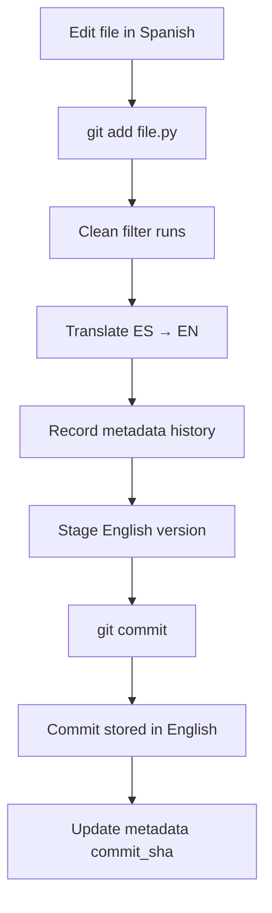
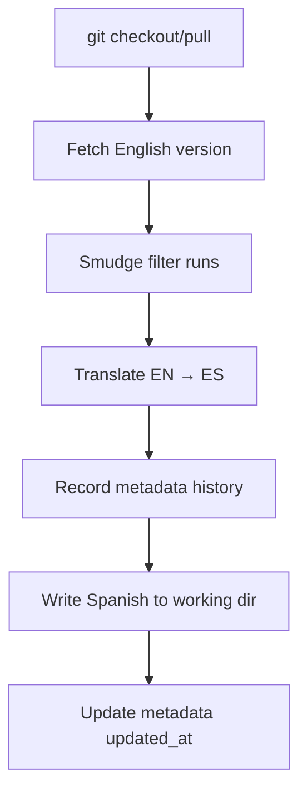

# Git Workflow with Metadata Tracking

How Legesher's git filters work with the metadata system to provide seamless multilingual version control.

## Overview

Legesher uses git filters to automatically translate code between your working directory language and
the canonical repository language (English by default). The metadata system tracks every translation
operation, providing a complete audit trail.

## Git Filter Architecture

### Clean Filter (Working → Git)

When you commit code, the **clean filter** translates from your working language to the canonical language:

```text
Working Directory (Spanish)        Git Repository (English)
─────────────────────────          ────────────────────────
definir calcular(x):      ──→      def calcular(x):
    retornar x * 2                     return x * 2

                    ↓
            Metadata Updated:
            - action: clean
            - from_language: es
            - to_language: en
            - timestamp: 2025-11-06T10:30:00Z
            - commit_sha: abc123
```

### Smudge Filter (Git → Working)

When you checkout or pull code, the **smudge filter** translates from canonical to your working language:

```text
Git Repository (English)           Working Directory (Spanish)
────────────────────────           ───────────────────────────
def calcular(x):          ──→      definir calcular(x):
    return x * 2                       retornar x * 2

                    ↓
            Metadata Updated:
            - action: smudge
            - from_language: en
            - to_language: es
            - timestamp: 2025-11-06T10:31:00Z
            - commit_sha: abc123
```

## Metadata During Git Operations

### Git Add / Commit Flow



**Metadata created:**

```yaml
history:
  - action: clean
    from_language: es
    to_language: en
    timestamp: "2025-11-06T10:30:00Z"
    commit_sha: abc123
```

### Git Checkout / Pull Flow



**Metadata created:**

```yaml
history:
  - action: smudge
    from_language: en
    to_language: es
    timestamp: "2025-11-06T10:31:00Z"
    commit_sha: abc123
```

## Complete Example Workflow

### Initial Setup

```bash
# Initialize Legesher in repository
cd /path/to/project
legesher git-setup --language es

# This creates:
# - .legesher/config.yml (configuration)
# - .gitattributes (git filter config)
# - .git/config (git filter commands)
```

**Created configuration:**

```yaml
# .legesher/config.yml
language: es
python_version: "3.13"
git:
  canonical_language: en
  filter_enabled: true
metadata:
  enabled: true
  directory: .legesher/metadata
  track_in_git: true
```

### Creating a New File

```bash
# Create file in Spanish
cat > src/calculator.py << 'EOF'
definir suma(a, b):
    """Suma dos números."""
    retornar a + b

definir resta(a, b):
    """Resta dos números."""
    retornar a - b
EOF
```

### First Commit

```bash
# Add and commit
git add src/calculator.py
git commit -m "Agregar calculadora"
```

**What happens:**

1. **Clean filter runs** on `git add`:
   - Translates Spanish → English
   - Creates metadata file

2. **Metadata created** at `.legesher/metadata/src/calculator.py.yml`:

   ```yaml
   file: src/calculator.py
   original_language: es
   canonical_language: en
   python_version: "3.13"
   created_at: "2025-11-06T10:30:00Z"
   updated_at: "2025-11-06T10:30:00Z"
   translations:
     - language: en
       method: token_transformer
       timestamp: "2025-11-06T10:30:00Z"
       commit_sha: null  # Not yet committed
       translator_version: "0.1.0"
       python_version: "3.13"
   history:
     - action: clean
       from_language: es
       to_language: en
       timestamp: "2025-11-06T10:30:00Z"
       commit_sha: null
   ```

3. **Git stores English version**:

   ```python
   def suma(a, b):
       """Suma dos números."""
       return a + b

   def resta(a, b):
       """Resta dos números."""
       return a - b
   ```

4. **After commit**, metadata updated with commit SHA:

   ```yaml
   history:
     - action: clean
       from_language: es
       to_language: en
       timestamp: "2025-11-06T10:30:00Z"
       commit_sha: abc123  # Now has commit SHA
   ```

### Viewing Metadata

```bash
# View metadata for the file
legesher metadata show src/calculator.py
```

**Output:**

```text
File: src/calculator.py
━━━━━━━━━━━━━━━━━━━━━━━━━━━━━━━━━━━━━━━━━━━━━━━━━━━━━━━━━━
Original Language:    es
Canonical Language:   en
Python Version:       3.13
Created:              2025-11-06 10:30:00 UTC
Last Updated:         2025-11-06 10:30:00 UTC

Translations
┏━━━━━━━━━━┳━━━━━━━━━━━━━━━━━━━┳━━━━━━━━━━━━━━━━━━━━━━┳━━━━━━━━━┳━━━━━━━━┓
┃ Language ┃ Method            ┃ Timestamp            ┃ Version ┃ Commit ┃
┡━━━━━━━━━━╇━━━━━━━━━━━━━━━━━━━╇━━━━━━━━━━━━━━━━━━━━━━╇━━━━━━━━━╇━━━━━━━━┩
│ en       │ token_transformer │ 2025-11-06 10:30:00  │ 0.1.0   │ abc123 │
└──────────┴───────────────────┴──────────────────────┴─────────┴────────┘

Recent History
┏━━━━━━━━━━━━━━━━━━━━━━┳━━━━━━━━┳━━━━━━┳━━━━┳━━━━━━━━┓
┃ Timestamp            ┃ Action ┃ From ┃ To ┃ Commit ┃
┡━━━━━━━━━━━━━━━━━━━━━━╇━━━━━━━━╇━━━━━━╇━━━━╇━━━━━━━━┩
│ 2025-11-06 10:30:00  │ clean  │ es   │ en │ abc123 │
└──────────────────────┴────────┴──────┴────┴────────┘
```

### Checkout on Another Machine

```bash
# Clone repository
git clone https://github.com/user/project.git
cd project

# Setup Legesher for Spanish
legesher git-setup --language es

# Checkout file (smudge filter runs)
git checkout main
```

**What happens:**

1. **Smudge filter runs** on checkout:
   - Translates English → Spanish
   - Updates metadata

2. **Metadata updated** (or created if not tracked in git):

   ```yaml
   translations:
     - language: en
       method: token_transformer
       timestamp: "2025-11-06T10:30:00Z"
       commit_sha: abc123
       translator_version: "0.1.0"
       python_version: "3.13"
     - language: es  # New entry
       method: token_transformer
       timestamp: "2025-11-06T10:31:00Z"
       commit_sha: abc123
       translator_version: "0.1.0"
       python_version: "3.13"
   history:
     - action: clean
       from_language: es
       to_language: en
       timestamp: "2025-11-06T10:30:00Z"
       commit_sha: abc123
     - action: smudge  # New entry
       from_language: en
       to_language: es
       timestamp: "2025-11-06T10:31:00Z"
       commit_sha: abc123
   ```

3. **Working directory has Spanish**:

   ```python
   definir suma(a, b):
       """Suma dos números."""
       retornar a + b

   definir resta(a, b):
       """Resta dos números."""
       retornar a - b
   ```

## Metadata in Team Workflows

### Scenario: Multiple Developers

**Developer A (Spanish):**

```bash
# Create feature in Spanish
definir nueva_funcion():
    retornar "hola"

git add src/feature.py
git commit -m "Nueva función"
git push
```

**Developer B (Arabic):**

```bash
# Pull changes
git pull  # Smudge: EN → AR

# Now sees:
تعريف nueva_funcion():
    إرجاع "hola"

# Edit in Arabic
تعريف nueva_funcion():
    إرجاع "مرحبا"

git add src/feature.py
git commit -m "تحديث الرسالة"  # Clean: AR → EN
git push
```

**Developer A (Spanish):**

```bash
# Pull changes
git pull  # Smudge: EN → ES

# Now sees:
definir nueva_funcion():
    retornar "مرحبا"
```

**Metadata shows complete history:**

```bash
legesher metadata history src/feature.py
```

**Output:**

```text
Translation History: src/feature.py
━━━━━━━━━━━━━━━━━━━━━━━━━━━━━━━━━━━━━━━━━━━━━━━━━━━━━━━━━━
┏━━━━━━━━━━━━━━━━━━━━━━┳━━━━━━━━┳━━━━━━━━━━━━━━┳━━━━━━━━┓
┃ Timestamp            ┃ Action ┃ Translation  ┃ Commit ┃
┡━━━━━━━━━━━━━━━━━━━━━━╇━━━━━━━━╇━━━━━━━━━━━━━━╇━━━━━━━━┩
│ 2025-11-06 10:45:00  │ smudge │ en → es      │ def456 │
│ 2025-11-06 10:44:00  │ clean  │ ar → en      │ def456 │
│ 2025-11-06 10:43:00  │ smudge │ en → ar      │ abc123 │
│ 2025-11-06 10:42:00  │ clean  │ es → en      │ abc123 │
└──────────────────────┴────────┴──────────────┴────────┘
```

## Troubleshooting Git + Metadata Issues

### Metadata Not Updated on Commit

**Problem:** After committing, metadata doesn't have commit SHA

**Cause:** Metadata is updated during git filter, but commit SHA is added later

**Solution:** This is expected behavior. The metadata gets the commit SHA after the commit completes.

### Git Diff Shows Metadata Changes

**Problem:** `git diff` shows changes in `.legesher/metadata/`

**Cause:** Metadata tracks git operations, so it changes with every clean/smudge

**Solution:** This is normal. Metadata should be committed alongside source changes.

### Merge Conflicts in Metadata

**Problem:** Git merge shows conflicts in metadata files

**Cause:** Multiple branches updating same metadata

**Solution:**

```bash
# Accept both changes and regenerate
git checkout --theirs .legesher/metadata/src/file.py.yml
git add .legesher/metadata/src/file.py.yml

# Or regenerate by re-running git filters
git checkout -- src/file.py
```

### Metadata Out of Sync After Rebase

**Problem:** After rebasing, metadata has old commit SHAs

**Cause:** Rebase changes commit SHAs but doesn't re-run filters

**Solution:**

```bash
# Force smudge filter to re-run
git checkout HEAD -- src/file.py

# Or reset all filters
rm -rf .legesher/metadata/
git checkout -- .
```

## Best Practices

### 1. Track Metadata in Git

**Recommended:**

```yaml
# .legesher/config.yml
metadata:
  track_in_git: true
```

**Benefits:**

- Team members see complete translation history
- Metadata preserved across clones
- Audit trail in git log

### 2. Review Metadata Changes

Before committing, review metadata changes:

```bash
# View metadata diff
git diff .legesher/metadata/

# View specific file metadata
legesher metadata show src/file.py
```

### 3. Clean Up Old History

For long-lived files, limit history entries:

```yaml
# .legesher/config.yml
metadata:
  max_history_entries: 50
```

### 4. Validate After Major Operations

After rebases, merges, or cherry-picks:

```bash
# Validate all metadata
for file in $(find . -name "*.py"); do
  legesher metadata validate "$file"
done
```

### 5. Document Language Choices

Add README explaining language setup:

```markdown
# Language Setup

This project uses Legesher for multilingual development.

## Setup Instructions

1. Install Legesher: `pip install legesher`
2. Configure language: `legesher git-setup --language es`
3. Checkout code: `git checkout main`

## Metadata

Translation metadata is tracked in `.legesher/metadata/`.
View with: `legesher metadata show <file>`
```

## Advanced: Custom Metadata Workflows

### Pre-commit Hook for Metadata Validation

```bash
#!/bin/bash
# .git/hooks/pre-commit

echo "Validating metadata..."

# Get staged Python files
staged_files=$(git diff --cached --name-only --diff-filter=ACM | grep "\.py$")

for file in $staged_files; do
  if ! legesher metadata validate "$file" &>/dev/null; then
    echo "❌ Invalid metadata: $file"
    echo "Run: legesher metadata show $file"
    exit 1
  fi
done

echo "✅ Metadata valid"
```

### Post-checkout Hook for Metadata Reporting

```bash
#!/bin/bash
# .git/hooks/post-checkout

echo "Translation summary:"
legesher metadata list | head -20
```

### CI Integration

```yaml
# .github/workflows/validate-metadata.yml
name: Validate Metadata

on: [push, pull_request]

jobs:
  validate:
    runs-on: ubuntu-latest
    steps:
      - uses: actions/checkout@v3

      - name: Setup Python
        uses: actions/setup-python@v4
        with:
          python-version: "3.13"

      - name: Install Legesher
        run: pip install legesher

      - name: Validate metadata
        run: |
          find . -name "*.py" -not -path "./.venv/*" | while read file; do
            legesher metadata validate "$file" || exit 1
          done
```

## Summary

The metadata system provides comprehensive tracking of all git filter operations:

- **Clean operations** (commit): Record ES → EN translations with commit SHAs
- **Smudge operations** (checkout): Record EN → ES translations
- **Complete audit trail**: View full history with `legesher metadata history`
- **Team collaboration**: Share metadata in git for team visibility
- **Debugging**: Identify when/how translations occurred

**Key Commands:**

```bash
# Setup git filters with metadata
legesher git-setup --language es

# View metadata
legesher metadata show src/file.py

# View history
legesher metadata history src/file.py

# Validate metadata
legesher metadata validate src/file.py

# List all tracked files
legesher metadata list
```

For more details, see the [Metadata User Guide](metadata-guide.md).
